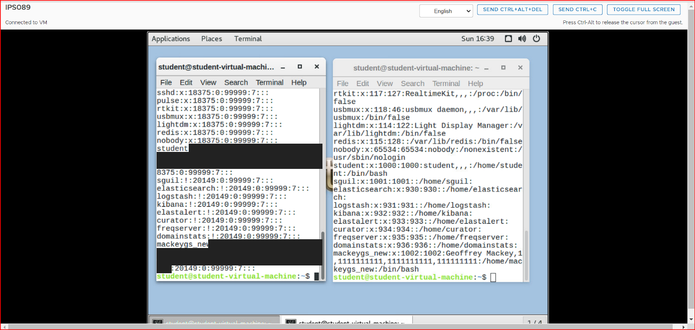
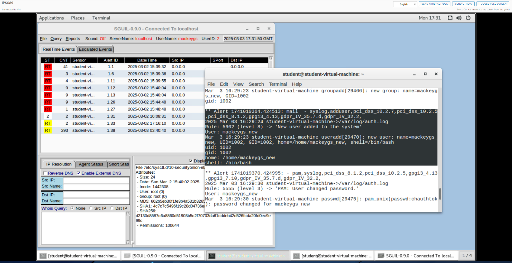
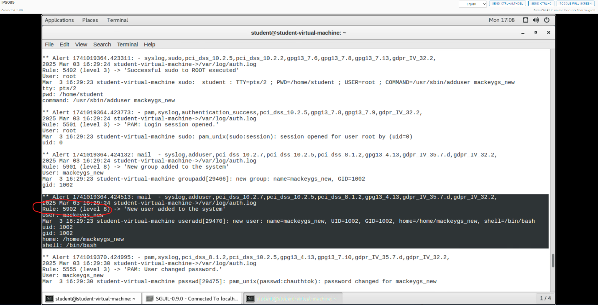
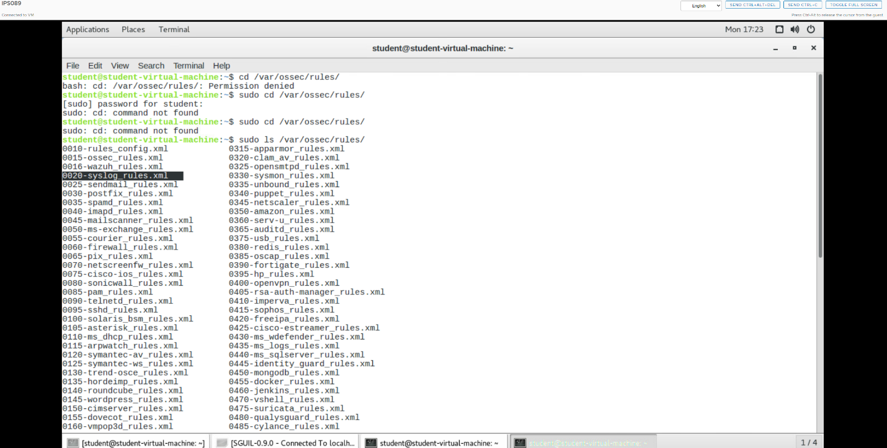
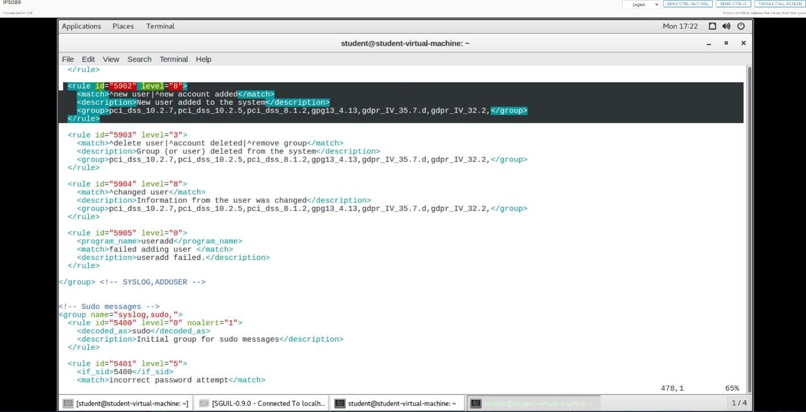

# Tracing a Host-Based Intrusion Alert: OSSEC Rule Analysis on Security Onion


A detection-engineering exercise in which I generated a known security event on a Linux host, then followed it all the way through the detection pipeline: from the raw system log, to the OSSEC host-based intrusion detection alert, to the exact rule definition that fired. The goal was to understand not just *that* an alert fires, but *why*, which is the foundation of triaging alerts, tuning noisy rules, and writing new detections.

The event I chose is a classic one for any SOC: **a new user account being created**. Unexpected account creation is a common persistence technique, so knowing exactly how it is detected, and where that logic lives, is directly useful in real investigations.

---

## Table of Contents

- [Highlights](#highlights)
- [Environment](#environment)
- [Step 1: Generate the Event](#step-1-generate-the-event)
- [Step 2: Look for the Alert in Sguil](#step-2-look-for-the-alert-in-sguil)
- [Step 3: Classify the Alert Source](#step-3-classify-the-alert-source)
- [Step 4: Find the Alert in the OSSEC Logs](#step-4-find-the-alert-in-the-ossec-logs)
- [Step 5: Trace the Rule to Its Definition](#step-5-trace-the-rule-to-its-definition)
- [Challenges and Troubleshooting](#challenges-and-troubleshooting)
- [What I Learned](#what-i-learned)

---

## Highlights

Creating a single account with `adduser` produced a chain of five OSSEC alerts, from the `sudo` escalation through to the password being set. The key detection, **Rule 5902 (level 8), "New user added to the system,"** fired from `/var/log/auth.log`. I traced that rule to its definition in `/var/ossec/rules/0020-syslog_rules.xml` at around line 478 and confirmed exactly which log pattern triggers it. The alert did not surface in the Sguil console, but it was fully recorded in OSSEC's own alert log, a useful reminder that the console is only one view of what the sensor sees.

---

## Environment

| Component | Details |
|-----------|---------|
| Platform | Security Onion sensor VM (Linux) |
| Host IDS | OSSEC agent monitoring local system logs |
| Analyst console | Sguil 0.9.0 |
| Log source | `/var/log/auth.log` |
| Test account | `mackeygs_new` |

OSSEC is an open-source **host-based** intrusion detection system (HIDS). Rather than inspecting network traffic, it watches what happens *on* a machine, including its logs, file integrity, and system changes, and raises alerts when activity matches its rules.

---

## Step 1: Generate the Event

I created a new local account to produce a known, timestamped security event:

```bash
sudo adduser mackeygs_new
```

Then I confirmed the account existed by checking the two files Linux uses to store account information. `/etc/passwd` holds the account record (`mackeygs_new:x:1002:1002:...:/home/mackeygs_new:/bin/bash`), and `/etc/shadow` holds the hashed password and password-aging data. The new account appears at the end of both.



> Password hashes from `/etc/shadow` have been redacted in this screenshot. Even in a lab, hashes shouldn't be published.

---

## Step 2: Look for the Alert in Sguil

With the event generated, I sorted Sguil's RealTime Events by date to look for a matching alert. **The new-user alert did not appear in the Sguil console.** Rather than stopping there, I went to the source and checked OSSEC's own alert log, where the event was fully recorded (see Step 4).



---

## Step 3: Classify the Alert Source

Before digging into the logs, I worked out where this kind of alert comes from.

| Question | Answer |
|----------|--------|
| Is it an OSSEC alert? | **Yes.** It is a host-based (HIDS) alert. |
| Is it a network monitoring alert? | No. Nothing crossed the network. |
| Does it come from a binder, connector, or interface? | No. |
| Does it originate from the `ens160` network interface? | No. |
| Where does it come from? | The **OSSEC agent running on the host**, which read the account-creation entries written to `/var/log/auth.log`. |

This distinction matters during triage: a network sensor would never see a local `adduser` command, so only host-based monitoring can catch it.

---

## Step 4: Find the Alert in the OSSEC Logs

OSSEC writes every alert to a plain-text log, which requires root access to read:

```bash
sudo su
cd /var/ossec/logs/alerts/
cat alerts.log

# Narrow it down to the new account
grep -A 10 "mackeygs_new" /var/ossec/logs/alerts/alerts.log
```

That one `adduser` command produced a whole chain of alerts, each describing a different part of what happened:

| Rule | Level | Description | What it captured |
|------|:-----:|-------------|------------------|
| 5402 | 3 | Successful sudo to ROOT executed | `student` ran `/usr/sbin/adduser mackeygs_new` via `sudo` |
| 5501 | 3 | PAM: Login session opened | `sudo` opened a root session |
| 5901 | 8 | New group added to the system | `groupadd` created group `mackeygs_new` (GID 1002) |
| **5902** | **8** | **New user added to the system** | `useradd` created user `mackeygs_new` (UID 1002, `/bin/bash`) |
| 5555 | 3 | PAM: User changed password | The new account's password was set |

The key alert block looks like this:

```text
** Alert 1741019364.424513: mail  - syslog,adduser,pci_dss_10.2.7,pci_dss_10.2.5,pci_dss_8.1.2,gpg13_4.13,gdpr_IV_35.7.d,gdpr_IV_32.2,
2025 Mar 03 16:29:24 student-virtual-machine->/var/log/auth.log
Rule: 5902 (level 8) -> 'New user added to the system'
User: mackeygs_new
Mar  3 16:29:23 student-virtual-machine useradd[29470]: new user: name=mackeygs_new, UID=1002, GID=1002, home=/home/mackeygs_new, shell=/bin/bash
```

Each alert also carries compliance tags such as `pci_dss_8.1.2` and `gdpr_IV_32.2`, which map the event to the PCI DSS and GDPR requirements it helps satisfy. That's useful for audit reporting.



---

## Step 5: Trace the Rule to Its Definition

With the rule ID in hand, I went looking for the rule itself. OSSEC's rules are stored as XML files in `/var/ossec/rules/`, grouped by log source:

```bash
sudo ls /var/ossec/rules/

# Find which file defines rule 5902, with its line number
sudo grep -rn 'id="5902"' /var/ossec/rules/
```

The rule lives in **`0020-syslog_rules.xml`**, inside the `syslog,adduser` rule group.



Opening the file showed the rule definition at around **line 478**:

```xml
<rule id="5902" level="8">
  <match>^new user|^new account added</match>
  <description>New user added to the system</description>
  <group>pci_dss_10.2.7,pci_dss_10.2.5,pci_dss_8.1.2,gpg13_4.13,gdpr_IV_35.7.d,gdpr_IV_32.2,</group>
</rule>
```

This closes the loop. The `useradd` log line begins with `new user:`, which matches the rule's `^new user` pattern, so OSSEC raised a level 8 alert with the rule's description and compliance tags. The neighboring rules in the same group cover the rest of the account lifecycle: 5903 for deleted users or groups, 5904 for changed user information, and 5905 for failed `useradd` attempts.



---

## Challenges and Troubleshooting

**The alert never showed up in Sguil.** The obvious place to look came up empty, but OSSEC's `alerts.log` had the full record. Instead of assuming the detection had failed, I verified it at the source. In a real SOC, that habit separates "the sensor missed it" from "the console didn't display it."

**`sudo cd` doesn't work.** My first attempts to enter the rules directory failed with `Permission denied`, and then `sudo: cd: command not found`. `cd` is a shell built-in, not a program, so `sudo` can't run it. The fix was to either run commands against the path directly (`sudo ls /var/ossec/rules/`) or switch to a root shell first with `sudo su`.

---

## What I Learned

Tracing one alert end to end made the detection pipeline concrete: an action on the host writes a line to a log, the HIDS agent reads it, a rule's pattern matches it, and an alert is produced with a severity, a description, and compliance tags. Knowing where that logic lives means I can explain *why* an alert fired instead of taking it on faith. That same knowledge is what you need to tune a noisy rule, write a custom one, or recognize when something important isn't being detected.

It also showed how much context a single action generates. One `adduser` command left a trail across five rules, from the privilege escalation to the password change, and correlating those alerts tells a much fuller story than any one of them alone. Finally, it reinforced why host-based monitoring is essential alongside network monitoring: account creation never touches the wire, so only a HIDS like OSSEC can see it.

---

## Author

**Geoffrey Mackey**, Cybersecurity and Information Technology student at the University of Cincinnati.
